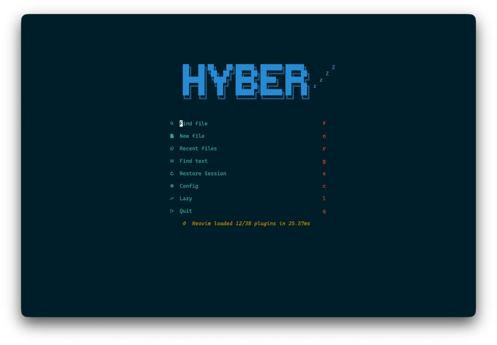

# Neovim setup

## Requirements

- [Neovim](https://neovim.io/) >= **0.12** (plugins are managed with [lazy.nvim](https://github.com/folke/lazy.nvim))
- [lazygit](https://github.com/jesseduffield/lazygit)
- [tree-sitter CLI](https://github.com/tree-sitter/tree-sitter) >= **0.26.1** and a **C compiler** to build parsers
- Dependencies for [fzf-lua](https://github.com/ibhagwan/fzf-lua):
  - [fzf](https://github.com/junegunn/fzf): fuzzy selection
  - [ripgrep](https://github.com/BurntSushi/ripgrep): live grep
  - [fd](https://github.com/sharkdp/fd): find files
